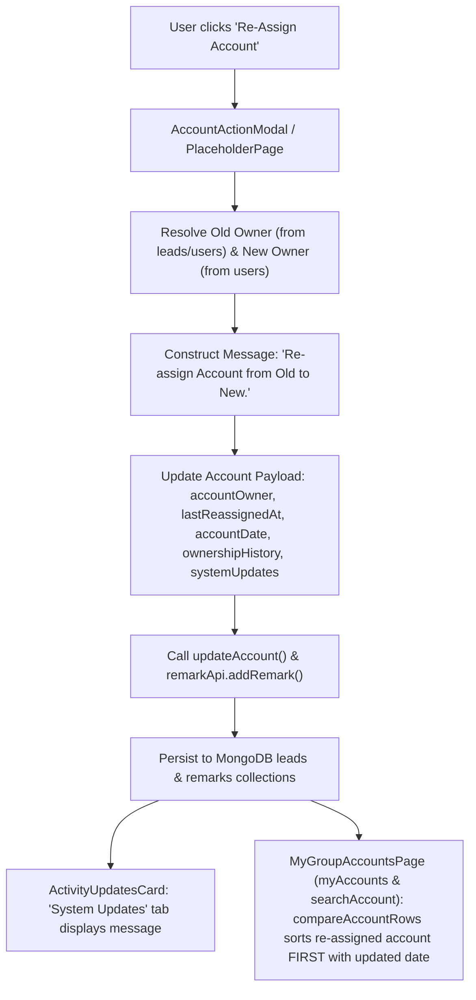

# Updated Implementation Plan: Account Re-Assignment System Updates & Search/Table Sort Elevation

## 1. Executive Summary & Objective

This updated plan incorporates user feedback to explicitly cover **Search Accounts** (`/admin/accounts/search` and `/accounts/search`) alongside **My Accounts** (`/admin/accounts/my-accounts` and `/accounts/my-accounts`), and ensures that the **date update and auto-first placement** occur specifically upon re-assignment while all other normal account behavior remains untouched.

### Target URLs:
- **Admin**:
  - `http://localhost:3000/admin/accounts/my-accounts?stage=new&page=1&accountId=5333`
  - `http://localhost:3000/admin/accounts/search?stage=new&page=1&accountId=5333`
  - `http://localhost:3000/admin/accounts/my-accounts?stage=new&page=1` *(Table View)*
  - `http://localhost:3000/admin/accounts/search?stage=new&page=1` *(Search Table View)*
- **Non-Admin Users**:
  - `http://localhost:3000/accounts/my-accounts?stage=new&page=1&accountId=5333`
  - `http://localhost:3000/accounts/search?stage=new&page=1&accountId=5333`
  - `http://localhost:3000/accounts/my-accounts?stage=new&page=1` *(Table View)*
  - `http://localhost:3000/accounts/search?stage=new&page=1` *(Search Table View)*

---

## 2. Core Functional Requirements

### Requirement 1: Dynamic System Update Message on Re-Assign
- When clicking the **Re-Assign Account** button and saving the re-assignment:
  - Dynamically retrieve the current/old owner name from the lead record in MongoDB `leads` and `users` collections.
  - Dynamically retrieve the new owner name from the MongoDB `users` collection.
  - Create and store the exact system message:
    ```text
    Re-assign Account from {OldOwnerName} to {NewOwnerName}.
    ```
    *(Example: `Re-assign Account from Keval V Shah to Jay Pandya.`)*
  - Render this message inside the **System Updates** tab on the **Activity & Updates** card in the Account Details drawer/modal.

### Requirement 2: Table Date Update & Auto-First Placement (My Accounts & Search Accounts)
- Specifically when an account is re-assigned:
  - Update the account's date fields (`lastReassignedAt`, `accountDate`, `updatedAt`) to the re-assignment timestamp (`Date.now()`).
  - In both **My Accounts** (`/admin/accounts/my-accounts`, `/accounts/my-accounts`) and **Search Accounts** (`/admin/accounts/search`, `/accounts/search`):
    - The table's date column displays this updated re-assignment date.
    - The table comparator (`compareAccountRows`) prioritizes the recent `lastReassignedAt` timestamp, immediately elevating the newly re-assigned account to the **first row (top of the table)**.
  - Accounts that have **not** been re-assigned continue following their normal historical creation ordering without disturbance.

---

## 3. Technical Architecture & Component Details



---

### Component 1: `src/pages/admin/accounts/AccountActionModal.jsx` & `AccountActionPlaceholderPage.jsx`
**Target Logic**: Re-assign action handling (`actionKey === 're-assign-account'`)

1. **Dynamic Name Resolution**:
   - Resolve old owner:
     ```javascript
     const resolveOwnerDisplayName = (rawOwner, ownerId) => {
       if (!rawOwner && !ownerId) return 'User'
       const match = ownerOptions.find((u) => (
         (ownerId && (String(u.id) === String(ownerId) || String(u._id) === String(ownerId)))
         || (rawOwner && (
           String(u.name || '').trim().toLowerCase() === String(rawOwner).trim().toLowerCase()
           || String(u.ownerDisplayName || '').trim().toLowerCase() === String(rawOwner).trim().toLowerCase()
           || String(u.username || '').trim().toLowerCase() === String(rawOwner).trim().toLowerCase()
           || String(u.ownerCode || '').trim() === String(rawOwner).trim()
         ))
       ))
       if (match) return match.ownerDisplayName || match.name || match.username
       const crmRecord = typeof getCrmOwnerRecord === 'function' ? getCrmOwnerRecord(rawOwner) : null
       if (crmRecord?.ownerDisplayName || crmRecord?.name) return crmRecord.ownerDisplayName || crmRecord.name
       return stripOwnerCodePrefix(rawOwner) || 'User'
     }

     const oldOwnerName = resolveOwnerDisplayName(
       account.accountOwnerDisplay || account.accountOwnerName || account.accountOwner || account.ownerName || account.raw?.accountOwner || account.raw?.ownerName,
       account.ownerId || account.assignedUserId || account.raw?.ownerId || account.raw?.assignedUserId
     )
     const newOwnerName = resolveOwnerDisplayName(owner?.ownerDisplayName || owner?.name || ownerName, owner?.id)
     ```
2. **Dynamic System Message**:
   ```javascript
   const reassignMessage = `Re-assign Account from ${oldOwnerName} to ${newOwnerName}.`
   ```
3. **Payload Structure with Re-Assign Timestamps**:
   ```javascript
   const reassignTimestamp = new Date().toISOString()
   const newOwnershipEntry = {
     id: `reassign-${Date.now()}`,
     title: 'Account Reassigned',
     content: reassignMessage,
     fromOwner: oldOwnerName,
     toOwner: newOwnerName,
     changedAt: reassignTimestamp,
     changedBy: user?.name || user?.username || 'System',
     author: user?.name || user?.username || 'System',
     createdAt: reassignTimestamp,
   }

   updates = {
     accountOwner: newOwnerName,
     ownerName: newOwnerName,
     ownerId: owner?.id || account.raw?.ownerId || null,
     assignedUserId: owner?.id || account.raw?.assignedUserId || null,
     accountOwnerCode: owner?.ownerCode || '',
     company: owner?.company || owner?.companyName || account.accountCategory || '',
     accountDate: reassignTimestamp,
     lastReassignedAt: reassignTimestamp,
     updatedAt: reassignTimestamp,
     latestRemark: reassignMessage,
     ownershipHistory: [
       ...(Array.isArray(account.ownershipHistory) ? account.ownershipHistory : (Array.isArray(account.raw?.ownershipHistory) ? account.raw.ownershipHistory : [])),
       newOwnershipEntry,
     ],
     systemUpdates: [
       ...(Array.isArray(account.systemUpdates) ? account.systemUpdates : (Array.isArray(account.raw?.systemUpdates) ? account.raw.systemUpdates : [])),
       newOwnershipEntry,
     ],
   }
   ```
4. **Persist System Remark**:
   ```javascript
   await remarkApi.addRemark({
     relatedEntityId: account.raw?.id || account.id,
     relatedEntityType: 'account',
     content: reassignMessage,
     type: 'system',
     category: 'system',
     title: 'Account Reassigned',
   }).catch(() => {})
   ```

---

### Component 2: `src/pages/admin/accounts/components/detail/ActivityUpdatesCard.jsx`
**Target Logic**: "System Updates" tab rendering

Include ownership/reassign updates directly inside `systemUpdates`:
```javascript
const ownershipUpdates = [
  ...(Array.isArray(account.ownershipHistory) ? account.ownershipHistory : []),
  ...(Array.isArray(account.raw?.ownershipHistory) ? account.raw.ownershipHistory : []),
  ...(Array.isArray(account.systemUpdates) ? account.systemUpdates : []),
  ...(Array.isArray(account.raw?.systemUpdates) ? account.raw.systemUpdates : []),
].map((entry, idx) => ({
  id: entry.id || `reassign-${idx}-${entry.changedAt || entry.createdAt}`,
  title: entry.title || 'Account Reassigned',
  content: entry.content || `Re-assign Account from ${entry.fromOwner} to ${entry.toOwner}.`,
  createdAt: entry.changedAt || entry.createdAt || account.updatedAt,
  author: entry.author || entry.changedBy || 'System',
}))

const systemRemarks = (Array.isArray(remarks) ? remarks : [])
  .filter((r) => r.type === 'system' || r.category === 'system' || r.title === 'Account Reassigned' || (r.content && String(r.content).startsWith('Re-assign Account from')))
  .map((r, idx) => ({
    id: r.id || `sys-remark-${idx}`,
    title: r.title || 'Account Reassigned',
    content: r.content || r.remark || '',
    createdAt: r.createdAt || r.date,
    author: r.createdByName || r.author || 'System',
  }))

const systemUpdates = [
  ...(account.createdAt ? [{
    id: 'sys-created',
    title: 'Account Created',
    content: `Account record was created by ${account.addedByDisplay || account.addedBy || 'User'}.`,
    createdAt: account.createdAt,
    author: account.addedByDisplay || account.addedBy || 'System',
  }] : []),
  ...(account.updatedAt && account.updatedAt !== account.createdAt ? [{
    id: 'sys-updated',
    title: 'Account Modified',
    content: `Account updated to status ${account.status || account.stage || 'Updated'}.`,
    createdAt: account.updatedAt,
    author: account.accountOwnerDisplay || account.accountOwner || 'System',
  }] : []),
  ...ownershipUpdates,
  ...systemRemarks,
  ...reminderUpdates,
].filter((item, index, self) => (
  index === self.findIndex((other) => other.content === item.content && String(other.createdAt).slice(0, 16) === String(item.createdAt).slice(0, 16))
)).sort((a, b) => new Date(b.createdAt || 0) - new Date(a.createdAt || 0))
```

---

### Component 3: `src/pages/admin/accounts/MyGroupAccountsPage.jsx`
**Target Logic**: Table Date Display & Auto-First Placement for both My Accounts & Search Accounts

1. **Unified Coverage**:
   - `MyGroupAccountsPage` powers both:
     - `variantKey="myAccounts"` (`/admin/accounts/my-accounts`, `/accounts/my-accounts`)
     - `variantKey="searchAccount"` (`/admin/accounts/search`, `/accounts/search`)
   - Both routes use the shared `compareAccountRows` comparator and column formatters.

2. **Table Date Column Formatting (`case 'accountDate'`)**:
   ```javascript
   case 'accountDate': {
     const dateVal = (
       row.lastReassignedAt
       || row.accountDate
       || row.raw?.lastReassignedAt
       || row.raw?.accountDate
       || row.updatedAt
       || row.raw?.updatedAt
       || row.createdAt
       || row.raw?.createdAt
       || ''
     )
     return formatDisplayDate(dateVal) || row.accountDateDisplay || ''
   }
   ```
   When an account has been re-assigned, its date in both My Accounts and Search Accounts tables reflects the re-assignment date.

3. **Re-Assign Auto-First Sorting Elevation (`compareAccountRows`)**:
   ```javascript
   const getRowSortTime = (row = {}) => {
     const candidate = (
       row.lastReassignedAt
       || row.raw?.lastReassignedAt
       || row.updatedAt
       || row.raw?.updatedAt
       || row.accountDate
       || row.raw?.accountDate
       || row.createdAt
       || row.raw?.createdAt
       || 0
     )
     const time = new Date(candidate).getTime()
     return Number.isNaN(time) ? 0 : time
   }

   const compareAccountRows = (left = {}, right = {}) => {
     const timeA = getRowSortTime(left)
     const timeB = getRowSortTime(right)
     if (timeA !== timeB) return timeB - timeA

     const leftId = Number(left.id || left.raw?.id || left.raw?._id) || 0
     const rightId = Number(right.id || right.raw?.id || right.raw?._id) || 0
     if (leftId !== rightId && leftId > 0 && rightId > 0) return rightId - leftId

     const leftNumber = String(left.accountNumber || left.accountNo || left.raw?.accountNumber || left.raw?.accountNo || '')
     const rightNumber = String(right.accountNumber || right.accountNo || right.raw?.accountNumber || right.raw?.accountNo || '')
     return rightNumber.localeCompare(leftNumber, undefined, { numeric: true, sensitivity: 'base' })
   }
   ```
   - When an account is re-assigned, its `lastReassignedAt` is set to the current timestamp (`Date.now()`).
   - In both My Accounts and Search Accounts tables, `timeB - timeA` ensures that the newly re-assigned account automatically sorts to **index 0 (first row at the top)**.
   - For accounts that have never been re-assigned, `lastReassignedAt` is undefined, so they cleanly fall back to `accountDate` / `createdAt` and preserve their existing natural ordering.

---

## 4. Affected Files Summary

| File | Functions / Sections | Changes |
| :--- | :--- | :--- |
| [`src/pages/admin/accounts/AccountActionModal.jsx`](file:///c:/Users/Lumos/Desktop/New-Server-VPS-CRM-PROD/src/pages/admin/accounts/AccountActionModal.jsx) | `handleSubmitAction` (`re-assign-account`) | Dynamically resolves old & new owner names; sets `Re-assign Account from {Old} to {New}.`; updates `lastReassignedAt`, `accountDate`, `updatedAt`, `ownershipHistory`, `systemUpdates`; adds system remark. |
| [`src/pages/admin/accounts/AccountActionPlaceholderPage.jsx`](file:///c:/Users/Lumos/Desktop/New-Server-VPS-CRM-PROD/src/pages/admin/accounts/AccountActionPlaceholderPage.jsx) | `handleSave` (`re-assign-account`) | Mirrors modal re-assign behavior for dedicated action routes. |
| [`src/pages/admin/accounts/components/detail/ActivityUpdatesCard.jsx`](file:///c:/Users/Lumos/Desktop/New-Server-VPS-CRM-PROD/src/pages/admin/accounts/components/detail/ActivityUpdatesCard.jsx) | `ActivityUpdatesCard` (`systemUpdates`) | Parses `ownershipHistory`, `systemUpdates`, and system remarks to render the re-assignment message in the **System Updates** tab. |
| [`src/pages/admin/accounts/MyGroupAccountsPage.jsx`](file:///c:/Users/Lumos/Desktop/New-Server-VPS-CRM-PROD/src/pages/admin/accounts/MyGroupAccountsPage.jsx) | `compareAccountRows` & `case 'accountDate'` | Updates date display and automatically elevates re-assigned accounts **first** across both My Accounts and Search Accounts for Admin and Non-Admin users. |

---

## 5. Strict Zero-Touch Guarantees

1. **Frontend-to-Backend Mapping**: Preserves exact database storage and MongoDB collection structures. Uses existing `updateAccount` and `remarkApi` services.
2. **Custom Report Engine**: Report creation, user group selection, and custom date filtering remain 100% untouched.
3. **Add Account Mechanism & Backend**: Account creation, validation, `ownerCode` assignment, and storage remain untouched.
4. **Deals & Quotations Backend**: Quotation numbering, $R0 \to R1 \to R2$ revision lifecycle, deal conversion, and deal detail views remain untouched.
5. **Mobile & Outlook Backends**: All communication and sync services remain untouched.
6. **Taskopad, Tasks, Reminders & Remarks**: Reminder popups, reminder forms, task calendar, and activity logs remain untouched.

---

## 6. Verification Steps (Post-Approval)

1. **Verification on My Accounts**:
   - Navigate to `/admin/accounts/my-accounts?stage=new&page=1&accountId=5333` (and `/accounts/my-accounts?stage=new&page=1&accountId=5333`).
   - Click **Re-Assign Account**, choose a new owner (e.g. Jay Pandya), and save.
   - Under **Activity & Updates**, open the **System Updates** tab and confirm:
     `Re-assign Account from Keval V Shah to Jay Pandya.`
   - In `/admin/accounts/my-accounts?stage=new&page=1` (and `/accounts/my-accounts?stage=new&page=1`), verify that account `#5333` appears **at the very top (first row)** with its updated date.

2. **Verification on Search Accounts**:
   - Navigate to `/admin/accounts/search?stage=new&page=1&accountId=5333` (and `/accounts/search?stage=new&page=1&accountId=5333`).
   - Verify re-assigning from search updates the System Updates message.
   - Return to `/admin/accounts/search?stage=new&page=1` (and `/accounts/search?stage=new&page=1`) and confirm the re-assigned account is sorted **first** with its updated date.

3. **Build Integrity**:
   - Run `npm run build` to ensure 0 errors or warnings across all modules.
