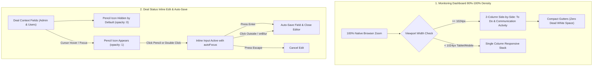

# Implementation Plan: CRM Monitoring 80%–100% Responsive Density & Deal Status Inline Auto-Save

> [!IMPORTANT]
> **PLAN ONLY — DO NOT IMPLEMENT**. As explicitly requested, this document provides the architectural analysis, technical root cause, and step-by-step implementation plan for:
> 1. **CRM-wide 80% to 100% Zoom Responsive Layout & Whitespace Elimination** across `/admin/monitoring`, `/monitoring` (User Dashboard), and global layout frames so that screens at standard 100% native zoom display the compact, side-by-side, high-density layout without dead white space.
> 2. **Deal Change Status Context Inline Edit Optimization** (`/admin/crm-actions/change-status` and `/crm-actions/change-status`) where the pencil icon hides by default and shows on cursor hover, with instant auto-save on **Enter key** and auto-save on **blur** (unfocus), available to both **Admin and Users**.
>
> **No code modifications will be made until your approval.**

---

## 1. Executive Summary & Root Cause Analysis

### Feature 1: 80% to 100% Zoom Responsive Layout & Whitespace Elimination
- **Target Pages**: `http://localhost:3000/admin/monitoring` (Admin Monitoring), `http://localhost:3000/monitoring` (User Monitoring / Dashboard), and shared CRM layouts.
- **The Core Problem**:
  - In `AdminPanel.css` (line `3586`) and `UserDashboardPage.css` (line `832`):
    ```css
    @media (max-width: 1366px) {
      .ap-monitoring-side-by-side {
        grid-template-columns: 1fr !important;
      }
      .ud-monitoring-side-by-side {
        grid-template-columns: 1fr !important;
      }
    }
    ```
  - On standard laptop screens (1366x768, 1280x800, or scaled 1080p/1440p displays at 125%/150%), viewing at **100% native browser zoom** triggers `@media (max-width: 1366px)`.
  - This collapses the 2-column side-by-side monitoring layout (`1.15fr 0.85fr`) into a single full-width vertical stack (`1fr !important`), pushing Communication Activities miles below the fold and leaving huge empty white space on wide displays.
  - When users zoom out to **80%** in Chrome/Edge, the browser's virtual CSS viewport expands from 1366px to `1366 / 0.8 = 1707px`, avoiding the media query and restoring the desired side-by-side layout!
- **Required Behavior**:
  - Adjust the collapse breakpoint from `1366px` down to tablet/mobile resolution (`1024px` / `980px`).
  - At default **100% native zoom**, laptops and desktop monitors immediately receive the clean, balanced 2-column side-by-side monitoring layout (`1.15fr 0.85fr`) with zero dead white space.
  - Compact vertical and horizontal gutters (`clamp(0.75rem, 1.2vw, 1rem)`) so the UI feels snug and dense at 100% zoom (mirroring the 80% zoom look).
  - Ensures seamless responsiveness whether the user zooms in or out (80%, 90%, 100%, 110%+).

---

### Feature 2: Deal Change Status Pencil Hover & Auto-Save
- **Target URLs**:
  - Admin: `http://localhost:3000/admin/crm-actions/change-status?module=deal&dealId=3013&returnTo=%2Fadmin%2Fdeals%2Fview`
  - User: `http://localhost:3000/crm-actions/change-status?module=deal&dealId=3013&returnTo=%2Fdeals%2Fview`
- **The Core Problem**:
  - In `CRMActionPage.jsx` (lines `1227–1272`), `.admin-deal-detail-field-edit-btn` (`<FiEdit2 />`) is permanently visible across all fields (`Deal Name`, `Deal No.`, `Contact Name`, `Email ID`, `Company Name`, `Deal Reference`), creating visual clutter.
  - In `renderInlineEditor` (lines `398–406`), inputs do not listen for `Enter` key presses or `onBlur` events, forcing users to manually click the "Save" button every time.
  - Non-admin user view was rendering static text instead of the interactive editable field cards.
- **Required Behavior**:
  - **Pencil Icon Hover Reveal**: The pencil icon (`.admin-deal-detail-field-edit-btn`) remains hidden by default (`opacity: 0; pointer-events: none;`) and smoothly appears (`opacity: 1; pointer-events: auto;`) only when the cursor hovers over the field (`:hover`) or when focused (`:focus-within`).
  - **Enter Key Auto-Save**: Pressing `Enter` inside the active edit input immediately saves the field and closes the editor. Pressing `Escape` cancels editing.
  - **Blur Auto-Save**: Clicking outside or moving focus away (`onBlur`) automatically triggers `handleSaveField(key)`, saving changes without requiring a manual button click.
  - **Both Admin and Users**: Both `/admin/crm-actions/...` and `/crm-actions/...` render this interactive auto-saving context cleanly.

---

## 2. Technical Architecture & Component Analysis



### Component Details

#### 1. `src/pages/admin/AdminPanel.css` & `src/pages/user/UserDashboardPage.css`
- **Breakpoint Adjustment**:
  - Change `@media (max-width: 1366px)` to `@media (max-width: 1024px)` for `.ap-monitoring-side-by-side` and `.ud-monitoring-side-by-side`.
  - Allows laptops (typically 1280px–1366px) at 100% zoom to maintain the 2-column side-by-side layout instead of collapsing into an empty 1-column stack.
- **Spacing & Padding Density**:
  - Reduce `.ap-monitoring-side-by-side` and `.ud-monitoring-side-by-side` gap from `1.25rem` to `0.95rem`.
  - Optimize `.ap-card-box` and `.ud-stat-card` padding for crisp enterprise density.
  - Ensure `.ap-todo-full-container` and `.ap-activity-box` utilize 100% of available column space without horizontal margin waste.

#### 2. `src/pages/admin/crm-actions/CRMActionPage.jsx` & `CRMActionPage.css`
- **Enable for Both Admin and Users**:
  - In `renderContext(dealOnly = true)`: Provide the structured, editable field layout for both admin and non-admin routes (`/crm-actions/change-status` and `/admin/crm-actions/change-status`).
- **Pencil Icon Hover Visibility in CSS**:
  ```css
  .admin-deal-detail-field-edit-btn {
    opacity: 0;
    transition: opacity 0.15s ease-in-out;
  }
  .admin-deal-detail-field:hover .admin-deal-detail-field-edit-btn,
  .admin-deal-detail-field:focus-within .admin-deal-detail-field-edit-btn {
    opacity: 1;
    pointer-events: auto;
  }
  ```
- **Enter Key & Blur Auto-Save in `renderInlineEditor`**:
  ```javascript
  const renderInlineEditor = (key, type = 'text') => (
    <div className="admin-deal-detail-inline-editor">
      <input
        type={type}
        value={editValue}
        autoFocus
        onChange={(e) => setEditValue(e.target.value)}
        onKeyDown={(e) => {
          if (e.key === 'Enter') {
            e.preventDefault()
            handleSaveField(key)
          } else if (e.key === 'Escape') {
            handleCancelEditing()
          }
        }}
        onBlur={() => handleSaveField(key)}
        disabled={isSavingField}
      />
      <div className="admin-deal-detail-inline-actions">
        <button type="button" onClick={() => handleSaveField(key)} disabled={isSavingField}>
          {isSavingField ? 'Saving...' : 'Save'}
        </button>
        <button type="button" onMouseDown={(e) => e.preventDefault()} onClick={handleCancelEditing} disabled={isSavingField}>
          Cancel
        </button>
      </div>
    </div>
  )
  ```

---

## 3. Step-by-Step Implementation Plan

### Step 1: Optimize Monitoring Breakpoints & Density (`AdminPanel.css` & `UserDashboardPage.css`)
1. File: `src/pages/admin/AdminPanel.css`
   - Change `@media (max-width: 1366px)` (line 3586) to `@media (max-width: 1024px)`.
   - Update `.ap-monitoring-side-by-side` grid gap from `1.25rem` to `0.95rem` to eliminate dead whitespace.
   - Adjust KPI grid and card min-heights to support compact display at 100% native zoom.
2. File: `src/pages/user/UserDashboardPage.css`
   - Change `@media (max-width: 1366px)` (line 832) to `@media (max-width: 1024px)`.
   - Update `.ud-monitoring-side-by-side` grid gap to `0.95rem`.
   - Ensure the user monitoring view mirrors admin monitoring density.

---

### Step 2: Implement Hover Pencil & Auto-Save on Deal Status Page (`CRMActionPage.jsx` & `CRMActionPage.css`)
1. File: `src/pages/admin/crm-actions/CRMActionPage.jsx`
   - In `renderContext(dealOnly = true)`:
     - Allow non-admin user view to render the interactive contextual deal fields.
     - For non-admin view, ensure the borderless container styling (`border: none`) remains respected while enabling editable fields.
   - In `renderInlineEditor`:
     - Add `autoFocus` to the input.
     - Add `onKeyDown` handler: `Enter` triggers `handleSaveField(key)`; `Escape` triggers `handleCancelEditing()`.
     - Add `onBlur` handler: Triggers `handleSaveField(key)` to auto-save when user clicks away.
     - Add `onMouseDown={(e) => e.preventDefault()}` on the Cancel button to prevent blur conflict when deliberately canceling.
2. File: `src/pages/admin/crm-actions/CRMActionPage.css`
   - Style `.admin-deal-detail-field-edit-btn`:
     - Default state: `opacity: 0; cursor: pointer; transition: opacity 0.15s ease;`
     - Hover/Focus state: `.admin-deal-detail-field:hover .admin-deal-detail-field-edit-btn, .admin-deal-detail-field:focus-within .admin-deal-detail-field-edit-btn { opacity: 1; }`
   - Ensure styles apply cleanly to both admin and user routes.

---

## 4. Verification & Testing Strategy

1. **Verify Monitoring 100% Zoom Responsive Density**:
   - Open `http://localhost:3000/admin/monitoring` at **100% browser zoom** on laptop and desktop screens.
   - Verify that the 2-column layout (To Do List on left, Communication Activity on right) stays side-by-side and does NOT collapse into a single column.
   - Verify that dead white space is eliminated and elements fit snugly on screen.
   - Zoom from 80% up to 100%+ and verify fluid stability without clipping.
   - Open `http://localhost:3000/monitoring` (User Dashboard) and verify identical side-by-side layout at 100% zoom.
2. **Verify Deal Change Status Hover Pencil & Auto-Save**:
   - Access `http://localhost:3000/admin/crm-actions/change-status?module=deal&dealId=3013&returnTo=%2Fadmin%2Fdeals%2Fview` as admin.
   - Verify that pencil icons are **hidden** by default.
   - Hover cursor over "Deal Name" -> Verify the pencil icon appears smoothly.
   - Click pencil icon -> Input opens with cursor focused.
   - Type new text and press **Enter** -> Verify deal updates and auto-saves immediately without clicking Save.
   - Edit another field and click outside (blur) -> Verify it auto-saves immediately.
   - Access `http://localhost:3000/crm-actions/change-status?module=deal&dealId=3013&returnTo=%2Fdeals%2Fview` as regular user and verify the exact same hover and auto-save behavior works.
3. **Build Verification**:
   - Run `npm run build` to confirm 0 compilation or bundling errors.

---

## 5. Strict Zero-Touch Commitments

- **Custom Reports**: Must NOT touch custom report creation logic or user groups / date filtering.
- **Add Account & ownerCode**: Must NOT touch Add Account mechanism or backend ownerCode.
- **Add Deals & Deal Details**: Must NOT touch Add Deals logic or backend payload structures.
- **Add Customers & Add Quotations**: Must NOT touch creation forms or backend logic.
- **Mobile Backend**: Must NOT touch mobile backend endpoints or logic.
- **Save Settings & Auto-Convert**: Must NOT touch deal conversion triggers or save settings.
- **Tasks & Reminders Form**: Must NOT modify reminders form schema, task creation mechanisms, or converted deals new tab opening.
- **Outlook & Quotations**: Must NOT touch Outlook integrations, quotation numbers, or revision workflows.
- **Taskopad & Graphs**: Must NOT touch Taskopad integrations or graph mechanisms.

