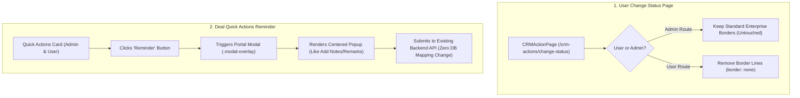

# Implementation Plan: User Change Status Border Removal & Quick Action Reminder Modal

> [!IMPORTANT]
> **PLAN ONLY — DO NOT IMPLEMENT**. As explicitly requested, this updated document details the technical analysis and step-by-step implementation plan for:
> 1. Removing the border line on `/crm-actions/change-status` specifically for regular users (leaving admin untouched).
> 2. Ensuring the Reminder button in the Quick Actions section on Deal Detail (`/admin/deals/view/:dealId` and `/deals/view/:dealId`) opens in a popup modal just like **Add Notes/Remarks**.
> 
> *Per your comment, Change 3 (80% to 100% Zoom Responsive Layout & Whitespace Elimination) has been completely removed from this plan and will NOT be implemented.*
>
> **No code modifications will be made until your explicit approval.**

---

## 1. Executive Summary & Objective

### Change 1: User Deal Change Status Page Border Removal
- **Target URL**: `http://localhost:3000/crm-actions/change-status?module=deal&dealId=3013&returnTo=%2Fdeals%2Fview`
- **Issue**: On the user route (`/crm-actions/...`), context boxes and deal status cards show slate/gray border lines (`1px solid #e2e8f0` / `var(--border-subtle)`).
- **Required Behavior**: 
  - For non-admin users (`.layout--user` / `!location.pathname.startsWith('/admin')`), remove the border line (`border: none !important`, `box-shadow: none !important`).
  - Seamless, borderless appearance specifically for users.
- **Admin Isolation**: Admin route (`http://localhost:3000/admin/crm-actions/change-status?...`) remains 100% untouched with its default enterprise borders preserved.

---

### Change 2: Quick Actions Reminder Button Opens Popup Modal (Like Add Notes/Remarks)
- **Target URLs**:
  - Admin: `http://localhost:3000/admin/deals/view/4356`
  - Non-Admin User: `http://localhost:3000/deals/view/4356`
- **Current Issue**:
  - Clicking **Add Remark** (`Add Notes/Remarks`) in Quick Actions opens `AddRemarksModal`, which uses `Modal.jsx` and `createPortal(..., document.body)` to render a centered popup modal on screen.
  - Clicking **Reminder** in Quick Actions currently triggers `AddReminderModal`, which renders inline within page stacking context without `createPortal`, causing it not to pop up cleanly or get clipped by container styling.
- **Required Behavior**:
  - Clicking the **Reminder** button inside the Quick Actions section on both admin and non-admin deal detail pages opens cleanly in a centered popup modal dialog, identical in user experience and backdrop to **Add Notes/Remarks**.
  - **Zero Database Mapping Changes**: Frontend-to-backend payload mappings (`reminderDate`, `reminderTime`, `reminderMode`, `note`, `assignedTo`, `relatedEntityId`) remain 100% intact.

---

## 2. Technical Root Cause & Architecture



### Component Analysis

#### 1. `src/pages/admin/crm-actions/CRMActionPage.jsx` & `CRMActionPage.css`
- In `renderContext(dealOnly = true)` (line `1208`):
  - Currently contains inline style: `border: '1px solid var(--border-subtle, #e2e8f0)'` specifically for `!location.pathname.startsWith('/admin')`.
  - Fix: Change inline style to `border: 'none'` for the user route.
- In `src/pages/admin/crm-actions/CRMActionPage.css`:
  - Add user-scoped CSS rules:
    ```css
    html.is-user .crm-action-page .crm-action-context,
    .layout--user .crm-action-page .crm-action-context,
    html.is-user .crm-deal-status-card,
    .layout--user .crm-deal-status-card {
      border: none !important;
      box-shadow: none !important;
    }
    ```
  - Admin view preserves standard borders.

#### 2. `src/components/common/AddReminderModal.jsx` & `src/pages/admin/deals/AdminDealDetailPage.jsx`
- In `AddReminderModal.jsx`:
  - Wrap the returned overlay in `createPortal(..., document.body)` (exact architecture used by `Modal.jsx` and `AddRemarksModal`).
  - Set `z-index: 2000` on `.arm-overlay` so it cleanly overlays the page header, sidebar, and detail cards.
  - Add body scroll lock (`document.body.style.overflow = 'hidden'`) while open, matching `AddRemarksModal`.
- In `AdminDealDetailPage.jsx`:
  - `handleQuickAction('add-reminder')` sets `setIsReminderOpen(true)`.
  - `<AddReminderModal ... />` receives `isOpen`, deal context, and `handleSavedReminder`.
  - Storing and updating in the database remains 100% unchanged.

---

## 3. Step-by-Step Implementation Plan

### Step 1: Remove Border Line on User Deal Change Status Page
1. File: `src/pages/admin/crm-actions/CRMActionPage.jsx`
   - In `renderContext(dealOnly = true)` for non-admin user routes (`!location.pathname.startsWith('/admin')`):
     - Remove `border: '1px solid var(--border-subtle, #e2e8f0)'` and replace with `border: 'none'`.
2. File: `src/pages/admin/crm-actions/CRMActionPage.css`
   - Target user layout (`.layout--user` and `html.is-user`):
     - Set `border: none !important; box-shadow: none !important;` on `.crm-action-context` and `.crm-deal-status-card`.
   - Leave all admin selectors and routes completely untouched.

---

### Step 2: Implement Quick Actions Reminder Popup via Portal (Like Add Notes/Remarks)
1. File: `src/components/common/AddReminderModal.jsx`
   - Import `createPortal` from `react-dom`.
   - Wrap `<div className="arm-overlay">...</div>` inside `createPortal(..., document.body)`.
   - Add scroll locking `useEffect` on `isOpen` (lock body overflow when open, unlock on close/unmount).
   - Ensure the modal card matches centered popup behavior.
2. File: `src/pages/admin/deals/AdminDealDetailPage.jsx`
   - Confirm that Quick Actions button `onQuickAction('add-reminder')` triggers `setIsReminderOpen(true)`.
   - Ensure `AddReminderModal` receives:
     - `isOpen={isReminderOpen}`
     - `contextLabel={`${deal?.dealName || 'Deal'} | ${deal?.dealNumber || ''}`}`
     - `relatedEntityType="deal"`
     - `relatedEntityId={deal?.id}`
     - `assignedTo={deal?.assignedTo || user?.id}`
     - `onSaved={handleSavedReminder}`
   - Keep `handleSavedReminder` and database update logic 100% untouched.

---

## 4. Verification & Testing Strategy

1. **Test User Change Status Page**:
   - Access `http://localhost:3000/crm-actions/change-status?module=deal&dealId=3013&returnTo=%2Fdeals%2Fview` as a regular user.
   - Verify that the card and context border lines are completely removed.
   - Access `http://localhost:3000/admin/crm-actions/change-status?...` as admin and verify admin borders remain intact.
2. **Test Quick Actions Reminder Popup**:
   - Access `http://localhost:3000/admin/deals/view/4356` as admin.
   - Click **Add Remark** -> Verify popup opens as centered overlay.
   - Click **Reminder** -> Verify popup opens in the exact same centered overlay popup style (via portal).
   - Access `http://localhost:3000/deals/view/4356` as non-admin user.
   - Click **Reminder** in Quick Actions -> Verify identical centered popup modal opens.
   - Create a test reminder and verify it saves successfully into the database without any mapping discrepancy.
3. **Build Verification**:
   - Run `npm run build` to confirm 0 compilation errors.

---

## 5. Strict Zero-Touch Scope Commitments

- **Change 3 Dropped**: No changes to 80%/100% zoom or responsive layout sizing on `/admin/monitoring` or global layouts.
- **Custom Reports**: Must NOT touch custom report creation logic or user groups / date filtering.
- **Add Account & ownerCode**: Must NOT touch Add Account mechanism or backend ownerCode.
- **Add Deals & Deal Details**: Must NOT touch Add Deals logic or backend payload structures.
- **Add Customers & Add Quotations**: Must NOT touch creation forms or backend logic.
- **Mobile Backend**: Must NOT touch mobile backend endpoints or logic.
- **Save Settings & Auto-Convert**: Must NOT touch deal conversion triggers or save settings.
- **Tasks & Reminders Form**: Must NOT modify reminders form schema, task creation mechanisms, or converted deals new tab opening.
- **Outlook & Quotations**: Must NOT touch Outlook integrations, quotation numbers, or revision workflows.
