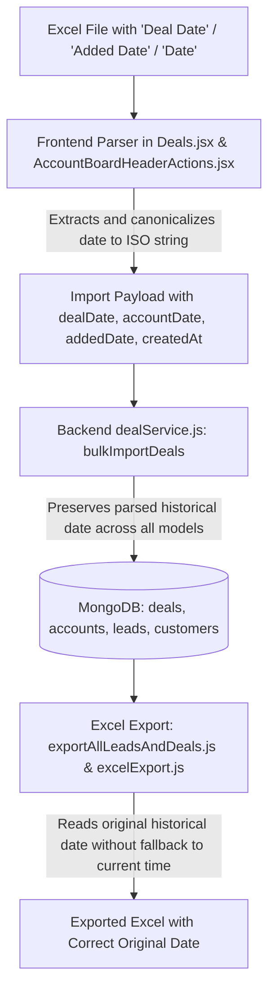

# Implementation Plan: Fix Date Overwrite with Today's Date During Excel Import & Export for Hasmukh and CRM Modules

## 1. Executive Summary & Problem Diagnosis

When importing data for user **Hasmukh Chauhan** (or any user from Maple CRM / Excel exports) and subsequently exporting it to Excel, the date column displays **Today's Date** (e.g., `16-10-2026` or `15-10-2026`) instead of the historical date present in the original Excel file (e.g., `21-06-2023`, `10-10-2023`).

### Exact Root Cause Breakdown

1. **Header Recognition Discrepancy During Import:**
   - In `Hasmukh Chauhan Template Name - 22 Sep 2026 Tue 04_33 pm.xls`, the date column is titled **`"Deal Date"`**.
   - In `Hasmukh bhai Template Name - 15 Oct 2026 Thu 05_55 pm.xls`, the date column is titled **`"Added Date"`**.
   - In `src/components/admin/accounts/AccountBoardHeaderActions.jsx` (Line 252), `rawDateInput` only looks for:
     `getVal('Added Date', 'addedDate', 'AddedDate', 'Added_Date', 'Account Date', 'Date', 'accountDate')`.
     It does **not** recognize `"Deal Date"`. Because of exact normalized matching, `"dealdate"` does not match `"date"`, resulting in `accountDate: undefined`.
   - In `src/pages/deals/Deals.jsx` (Line 3637), `rawDealDate` checks:
     `getVal(row, 'Deal Date', 'Date', 'Expected Close Date', 'Close Date')`.
     It does not explicitly recognize `"Added Date"` or `"Account Date"`.
     Furthermore, in `Deals.jsx` (Lines 3675–3711), the constructed import payload **only** sends `dealDate`. It completely omits `accountDate`, `addedDate`, and `createdAt`.

2. **Backend Date Fallback to `new Date()` (`server/services/dealService.js`):**
   - In `bulkImportDeals` (Lines 908–920):
     `rawDateCandidate` checks `row.accountDate || row.addedDate || row.createdAt...`
     When importing through Deals or when `accountDate` is omitted, `rawDateCandidate` is empty.
   - At Line 1051:
     `createdAt: (collectionName === 'accounts' && resolvedAccountDate) ? resolvedAccountDate : new Date().toISOString()`
     Because `resolvedAccountDate` is null, `createdAt` defaults to `new Date().toISOString()` (**today's timestamp**).
   - In Dual Ingestion for `leads` (Line 1129):
     `createdAt: new Date().toISOString()` is hardcoded, completely ignoring `dealDate` or the imported date.

3. **Fallback in Export & Display Formatter:**
   - In `src/features/adminAccounts/config/accountBoardColumns.js` (`formatLegacyBoardDate`, Line 124):
     ```javascript
     const dateVal = value || row.accountDate || row.accountDateDisplay || row.addedDate || row.formData?.['Added Date'] || row.createdAt
     ```
     Because `accountDate` and `addedDate` were saved as empty/undefined, it falls back to `row.createdAt`.
   - In `src/utils/exportAllLeadsAndDeals.js` (Line 251):
     ```javascript
     const rawDate = deal.dealDate || deal.createdAt || deal.quotationDate || ''
     ```
     If `dealDate` is empty, it falls back to `deal.createdAt`.
   - Result: Both table views and exported Excel files show **Today's Date** (the date the script/import was executed) rather than the original date from the spreadsheet.

---

## 2. Proposed Architecture & Solution Plan



---

## 3. Step-by-Step Implementation Steps (Do Not Implement Yet - Review Only)

### Phase 1: Frontend Header Recognition & Date Normalization
1. **Update `src/components/admin/accounts/AccountBoardHeaderActions.jsx`:**
   - Expand `rawDateInput` candidate keys to include:
     `'Deal Date'`, `'dealDate'`, `'Added Date'`, `'addedDate'`, `'Account Date'`, `'accountDate'`, `'Date'`, `'Created Date'`.
   - Ensure the parsed date is set on `accountDate`, `addedDate`, `dealDate`, and `createdAt` in the import payload.
2. **Update `src/pages/deals/Deals.jsx`:**
   - Expand `rawDealDate` extraction candidate keys to include:
     `'Deal Date'`, `'Added Date'`, `'Account Date'`, `'Date'`, `'Created Date'`, `'Expected Close Date'`.
   - In `dealsToImport.push({...})`, explicitly populate:
     `dealDate: dealDate || undefined`,
     `accountDate: dealDate || undefined`,
     `addedDate: dealDate || undefined`,
     `createdAt: dealDate ? new Date(dealDate).toISOString() : undefined`.

### Phase 2: Backend Date Ingestion & Multi-Collection Sync
1. **Update `server/services/dealService.js` (`bulkImportDeals`):**
   - Resolve date candidate from all possible fields:
     `const rawDateCandidate = cleanStr(row.dealDate || row.accountDate || row.addedDate || row.createdAt || row.formData?.dealDate || row.formData?.accountDate || row.formData?.['Added Date'] || row.formData?.['Deal Date'])`
   - Set `resolvedDate` across all document fields:
     - `dealDate`: formatted string (e.g., `YYYY-MM-DD`)
     - `accountDate`: ISO string
     - `addedDate`: ISO string
     - `createdAt`: `resolvedDate ? new Date(resolvedDate).toISOString() : new Date().toISOString()`
   - Ensure dual ingestion into `leads` and `customers` respects and carries `resolvedDate` into `createdAt`, `formData.accountDate`, `formData.dealDate`, and `formData['Added Date']`.

### Phase 3: Export Formatter Hardening
1. **Update `src/utils/exportAllLeadsAndDeals.js`:**
   - For Deals: Check `deal.dealDate || deal.accountDate || deal.addedDate || deal.formData?.dealDate || deal.createdAt`.
   - For Accounts: Prioritize `lead.accountDate || lead.addedDate || lead.dealDate || lead.formData?.['Added Date'] || lead.formData?.['Deal Date'] || lead.formData?.accountDate`.
   - Prevent falling back to `createdAt` if it matches the current date or import timestamp and a valid original date exists in `formData` or raw attributes.

### Phase 4: Data Remediation / Re-import for Hasmukh Chauhan
1. Create a safe migration/re-import script `tools/reimport_hasmukh_dates.cjs` (or `tools/patch_hasmukh_dates.cjs`):
   - Reads the original source Excel files from `C:\Users\DELL\Downloads\Hasmukh Chauhan Template Name - 22 Sep 2026 Tue 04_33 pm.xls` and `Hasmukh bhai Template Name - 15 Oct 2026 Thu 05_55 pm.xls`.
   - Matches records in MongoDB for user Hasmukh Chauhan (`ownerCode: '1002'` / `userId: 5`).
   - Updates `dealDate`, `accountDate`, `addedDate`, `formData.accountDate`, `formData['Added Date']`, and `createdAt` with the exact historical dates (`21-06-2023`, `10-10-2023`, etc.).
   - Runs in `--dry-run` mode first to verify counts before updating.

---

## 4. Verification & Testing Checklist

- [ ] Run dry-run inspection script to compare Excel row dates vs. database record dates for Hasmukh Chauhan.
- [ ] Verify frontend date parser correctly parses `DD-MM-YYYY` (`21-06-2023` -> `2023-06-21`).
- [ ] Test Deals import modal with Maple CRM files containing `"Deal Date"` and `"Added Date"`.
- [ ] Export workbook via "Export All Leads & Deals" and single-page Excel export.
- [ ] Open the exported Excel file and verify the "Account Date" and "Deal Date" columns display `21-06-2023` / `10-10-2023` instead of today's date (`16-10-2026`).
- [ ] Ensure non-Hasmukh records and other sales team records remain completely unaffected.
