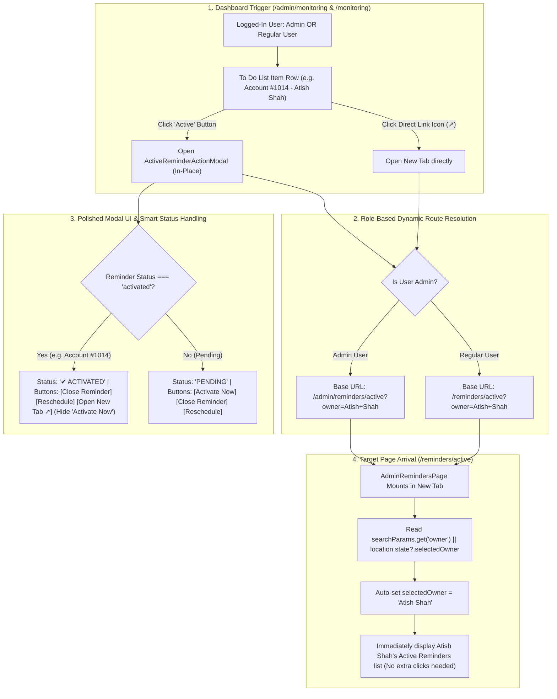

# Implementation Plan: Dual-Role (Admin & All Users) Active Reminders Pop-Up, Direct New Tab Link & Target Page Auto-Selection

This updated plan provides the exact procedure to ensure **both Administrators and All Regular Users** can seamlessly inspect reminders on their monitoring dashboards ([`/admin/monitoring`](file:///c:/Users/Lumos/Desktop/Server-New-Vps-CRM/src/pages/admin/AdminPanel.jsx) and [`/monitoring`](file:///c:/Users/Lumos/Desktop/Server-New-Vps-CRM/src/pages/user/UserDashboardPage.jsx)), open active reminders in a **New Tab / New Page**, auto-select the target owner on [`/admin/reminders/active`](file:///c:/Users/Lumos/Desktop/Server-New-Vps-CRM/src/pages/admin/reminders/AdminRemindersPage.jsx) or [`/reminders/active`](file:///c:/Users/Lumos/Desktop/Server-New-Vps-CRM/src/pages/admin/reminders/AdminRemindersPage.jsx), and properly format the modal UI so already activated items do not show redundant buttons.

---

## 1. Problem Analysis & Root Cause

1. **Dual-Role Route Guard Disconnect (Admin vs. Regular Users)**:
   - **Root Cause**: The CRM uses two parallel route trees in [`src/App.jsx`](file:///c:/Users/Lumos/Desktop/Server-New-Vps-CRM/src/App.jsx):
     - **Admin Tree**: Wrapped in `<ProtectedRoute requireAdmin>`, using `/admin/monitoring` and `/admin/reminders/active`.
     - **User Tree**: Accessible to all logged-in users, using `/monitoring` and `/reminders/active`.
   - When a non-admin user clicks a hardcoded link pointing to `/admin/reminders/active`, they are rejected by the admin route guard.
   - **Requirement**: The direct link and pop-up logic must dynamically resolve the base URL:
     - For Admins: `/admin/reminders/active`
     - For Regular Users: `/reminders/active`

2. **Target Owner Not Pre-Selected on Arrival ("Did not proper way display")**:
   - In [`src/pages/admin/reminders/AdminRemindersPage.jsx`](file:///c:/Users/Lumos/Desktop/Server-New-Vps-CRM/src/pages/admin/reminders/AdminRemindersPage.jsx) (which handles both `/admin/reminders/active` and `/reminders/active`), `selectedOwner` is initialized to `null`.
   - **Root Cause**: `AdminRemindersPage.jsx` does not currently read URL search parameters (`searchParams.get('owner')`) or `location.state?.selectedOwner`.
   - When an Admin lands on `/admin/reminders/active`, the system shows the generic *"Select a Team Member"* prompt instead of immediately displaying Atish Shah's active tasks.

3. **Dedicated "Open in New Page / New Tab" Requirement**:
   - Navigating within the same tab causes users to lose their monitoring dashboard session, filters, and KPI cards.
   - Users require a direct **New Tab (`window.open(..., '_blank')`)** capability so the monitoring dashboard stays active in one tab while the active reminders page opens in a new tab.

4. **Modal Button State & Redundancy on Already Activated Reminders**:
   - When inspecting an item that is already `ACTIVATED` (such as Account #1014 for Atish Shah):
     - The modal header shows `Current Status: ACTIVATED`.
     - However, the footer still renders an active **[Activate Now]** button, confusing the user.
   - **Requirement**: If `status === 'activated'`, display a green `✔ ACTIVATED` badge and show actions relevant to an active reminder: **[Close Reminder]**, **[Reschedule]**, and **[Open in New Page ↗]** (hide or disable the redundant "Activate Now" button).

---

## 2. Proposed Architecture & Implementation Steps



---

### Step 1: Update `AdminRemindersPage.jsx` for Instant Owner Auto-Selection
- **File**: [`src/pages/admin/reminders/AdminRemindersPage.jsx`](file:///c:/Users/Lumos/Desktop/Server-New-Vps-CRM/src/pages/admin/reminders/AdminRemindersPage.jsx)
- **Modifications**:
  1. Import `useSearchParams` from `react-router-dom`:
     ```javascript
     import { useLocation, useSearchParams } from 'react-router-dom'
     ```
  2. Read query params and initialize/set `selectedOwner`:
     ```javascript
     const [searchParams] = useSearchParams()

     useEffect(() => {
       if (variantKey !== 'active') return

       const requestedOwner = searchParams.get('owner') || location.state?.selectedOwner
       if (requestedOwner) {
         const matchingUser = activeReminderUsers.find(
           (u) => normalizeCrmUserName(u) === normalizeCrmUserName(requestedOwner)
         )
         if (matchingUser) {
           setSelectedOwner(matchingUser)
           return
         }
       }

       // Fallback for regular user if not specified
       if (!isAdmin && userGroups.length > 0 && !selectedOwner) {
         setSelectedOwner(userGroups[0].name)
       }
     }, [activeReminderUsers, isAdmin, location.state, searchParams, userGroups, variantKey])
     ```
  3. If `searchParams.get('tab')` is present (e.g. `?tab=pending`), automatically activate that detail tab.

---

### Step 2: Role-Aware Routing & New Tab Opening in `ActiveReminderActionModal.jsx`
- **File**: [`src/pages/admin/reminders/ActiveReminderActionModal.jsx`](file:///c:/Users/Lumos/Desktop/Server-New-Vps-CRM/src/pages/admin/reminders/ActiveReminderActionModal.jsx)
- **Modifications**:
  1. Determine dynamic base URL based on `isAdmin`:
     ```javascript
     const baseActiveUrl = isAdmin ? '/admin/reminders/active' : '/reminders/active'
     ```
  2. Build destination URL helper:
     ```javascript
     const buildTargetUrl = (owner, reminderId) => {
       const params = new URLSearchParams()
       if (owner && owner !== 'Unassigned') params.set('owner', owner)
       if (reminderId) params.set('reminderId', reminderId)
       return `${baseActiveUrl}${params.toString() ? `?${params.toString()}` : ''}`
     }
     ```
  3. **New Tab Opening Handler**:
     ```javascript
     const handleOpenInNewTab = (event) => {
       event?.stopPropagation()
       const url = buildTargetUrl(ownerName, reminder?.id || reminder?.sourceId)
       window.open(url, '_blank', 'noopener,noreferrer')
     }
     ```
  4. Provide two distinct link buttons:
     - `[Open in New Tab ↗]`: Opens in a new browser tab/window without leaving the dashboard.
     - `[Open in Current Tab]`: Performs in-page navigation if the user prefers.

---

### Step 3: Polish Modal Layout & Smart Button States for Activated Reminders
- **File**: [`src/pages/admin/reminders/ActiveReminderActionModal.jsx`](file:///c:/Users/Lumos/Desktop/Server-New-Vps-CRM/src/pages/admin/reminders/ActiveReminderActionModal.jsx)
- **Modifications**:
  1. Detect already activated status:
     ```javascript
     const isAlreadyActivated = String(reminder?.status || '').toLowerCase() === 'activated'
     ```
  2. Smart Button Rendering:
     - If `isAlreadyActivated`:
       - Show clear badge: `✔ ACTIVATED (IN PROGRESS)`
       - **Do NOT render the "Activate Now" button** (removes confusion for Account #1014).
       - Render: `[Close Reminder]`, `[Reschedule]`, and `[Open in New Tab ↗]`.
     - If `status === 'active'` (pending activation):
       - Render primary green `[Activate Now]` button.
  3. Visual Styling Polish in `ActiveReminderActionModal.css`:
     - Clear card borders, compact vertical spacing, and prominent New Tab badges.

---

### Step 4: Integrate Dual-Role Support in `UserDashboardPage.jsx` & `AdminPanel.jsx`
- **Files**:
  - [`src/pages/admin/AdminPanel.jsx`](file:///c:/Users/Lumos/Desktop/Server-New-Vps-CRM/src/pages/admin/AdminPanel.jsx) (for Admins)
  - [`src/pages/user/UserDashboardPage.jsx`](file:///c:/Users/Lumos/Desktop/Server-New-Vps-CRM/src/pages/user/UserDashboardPage.jsx) (for Regular Users)
- **Modifications**:
  1. On the To Do List row in both pages:
     - The direct link icon (`FaExternalLinkAlt`) uses `window.open(buildTargetUrl(...), '_blank')` so both Admins and Regular Users can open their active reminders page in a new tab.
  2. Clicking "Active" opens the `ActiveReminderActionModal` with `isAdmin={isAdmin}` passed dynamically.

---

## 3. Strict Non-Regression Safeguards

The implementation strictly guarantees:
- **Zero modification** to backend reminder endpoints (`/api/reminders`, `/api/deals`, `/api/accounts`, `/api/support-requests`).
- **Zero modification** to Add Account mechanism, `ownerCode` backend, and account ownership assignment.
- **Zero modification** to Add Deals logic, Deal details backend, and Deal creation.
- **Zero modification** to Quotations, Quotation Revisions, and Customers modules.
- **Zero modification** to Sales Performance email scheduler, report service, or KPI overview cards.
- **Zero modification** to Mobile backend, Taskpad, or Outlook/Graph mechanisms.
- **Complete role isolation**: Regular users are never directed to `/admin/*` routes; Admins retain full override permissions.

---

## 4. Verification & Testing Steps

1. **Admin New Tab Test (Account #1014)**:
   - Log in as Admin and visit `http://localhost:3000/admin/monitoring`.
   - Click "Active" on Account #1014 (Atish Shah).
   - **Expected**: Modal displays cleanly. Since it is already `ACTIVATED`, the redundant "Activate Now" button is hidden.
   - Click `[Open in New Tab ↗]`.
   - **Expected**: A new tab opens at `/admin/reminders/active?owner=Atish+Shah`, and Atish Shah's active reminders are automatically displayed on the page without showing "Select a Team Member".
2. **Regular User Test**:
   - Log in as a Regular User and visit `http://localhost:3000/monitoring`.
   - In the To Do List, click the Direct Link icon or modal link.
   - **Expected**: Opens `/reminders/active?owner=[User]` in a new tab without being blocked by admin route guards.
3. **In-Place Actions Test**:
   - Test "Close Reminder" and "Reschedule" from within the modal $\rightarrow$ updates database and refreshes To Do row in-place.
4. **Build Integrity**:
   - Run `npm run build` to confirm zero compilation or lint errors.
