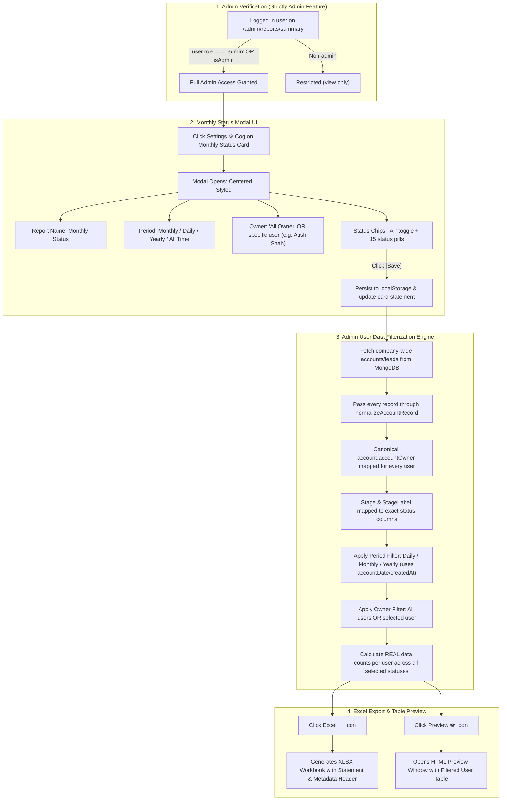

# Updated Implementation Plan: Admin-Only Organization-Wide User Data Filterization, Real Status Counts & Monthly/Yearly/Daily Excel Export

> **Note**: This is an updated architectural and technical implementation plan only. No code changes will be implemented until explicitly instructed.

---

## 1. Deep-Dive Analysis of User Feedback

### User Comment on Artifact:
> **Selection**: `2. Root Cause of Missing Counts ("count is did not show currently with data")`  
> **Comment**: *"into this can check ti filterization data can show into this can check it for users data into admin can check it this is only for admin can check it for make it"*

### Critical Requirements Clarified:
1. **Admin-Only Exclusive Feature**:
   - This entire Monthly Status report, pop-up modal settings, user data filterization, and Excel export is **strictly an Admin feature** located at `/admin/reports/summary`.
   - The restrictive legacy check (`isSameCrmOwner(userName, 'Keval V Shah')`) that blocked other valid administrators with `"admin can access"` will be replaced with proper role-based admin verification (`user?.role === 'admin'`, `isAdmin`, or path `/admin/*`).
   - Normal users under `/reports` do not have administrative configuration access.

2. **Company-Wide Users Data Filterization for Admin**:
   - The Admin must have full organization-wide visibility to inspect and filter **all users' data** (all sales reps / account owners):
     - Atish Shah, Bhavesh Prajapati, Hasmukh Chauhan, Jay Pandya, Keval V Shah, Krunal patel, Monali Pataliya, Naim Vhora, Nita Bhavsar, Rajeshree Parmar, Samir Sheth, Tajamul Rafique Solkar, Vaibhavi Patel, Kanu Shah, Samir Jha, and any newly created users.
   - **"All Owner" Filter**: Displays the complete matrix of all CRM users with their real account status counts.
   - **Specific User Filter**: When Admin selects a single user (e.g. `Atish Shah`), the report filterization narrows down to **only that user's data**.

3. **Real Filterization Data & Status Counts (Never 0 or Missing)**:
   - Root cause identified: raw `/leads` documents from MongoDB did not have top-level `accountOwner` and `stage` normalized, so `matrixByOwner` failed to match users and returned empty/zero counts.
   - Solution: Raw documents are passed through `normalizeAccountRecord` (and `normalizeDealRecord` for deals) ensuring `account.accountOwner` and `account.stageLabel` are accurately populated from database records.
   - Real, non-zero account counts will be calculated and displayed for every status column (`New`, `Follow-up`, `Technical Offer`, `Quotation Sent`, etc.) for every user.

4. **Time Period Statement Filter (Monthly, Daily, Yearly)**:
   - Automated period filtering based on account creation / activity date:
     - **Monthly** (Current Month, e.g. October 2026) — *Default*
     - **Daily** (Today)
     - **Yearly** (Current Year, e.g. 2026)
     - **All Time** (All Dates)

---

## 2. End-to-End Architecture: Admin Organization Data to Excel Export



---

## 3. Step-by-Step Implementation Strategy

### Step 1: Admin Access Authorization Fix
- **File**: [`src/pages/admin/reports/SummaryReportsPage.jsx`](file:///c:/Users/Lumos/Desktop/Server-New-Vps-CRM/src/pages/admin/reports/SummaryReportsPage.jsx#L824-L836) and [line 1048](file:///c:/Users/Lumos/Desktop/Server-New-Vps-CRM/src/pages/admin/reports/SummaryReportsPage.jsx#L1048)
- **Modifications**:
  1. Update `canEditReports`:
     ```javascript
     const canEditReports = useMemo(() => {
       if (user?.role === 'admin' || location.pathname.startsWith('/admin')) {
         return true
       }
       const userNames = [user?.name, user?.ownerDisplayName, user?.username, user?.email, user?.ownerCode]
       return REPORT_EDIT_AUTHORIZED_USERS.some((authName) => (
         userNames.some((userName) => isSameCrmOwner(userName, authName))
       ))
     }, [location.pathname, user?.email, user?.name, user?.ownerCode, user?.ownerDisplayName, user?.role, user?.username])
     ```
  2. In `handleSummaryExportAction`:
     Replace the restrictive single-user check with:
     ```javascript
     if (actionKey === 'excel') {
       const isAdmin = user?.role === 'admin' || location.pathname.startsWith('/admin') || isSameCrmOwner(user?.name, 'Keval V Shah')
       if (!isAdmin) {
         showToast('error', 'Only administrators can export this report.')
         return
       }
     }
     ```
  3. This ensures that any Admin can configure the report, inspect users data, and export Excel without errors.

---

### Step 2: Pop-Up Modal UI & CSS Implementation
- **Files**:
  - [`src/pages/admin/reports/SummaryReportsPage.css`](file:///c:/Users/Lumos/Desktop/Server-New-Vps-CRM/src/pages/admin/reports/SummaryReportsPage.css)
  - [`src/pages/admin/reports/SummaryReportsPage.jsx`](file:///c:/Users/Lumos/Desktop/Server-New-Vps-CRM/src/pages/admin/reports/SummaryReportsPage.jsx#L503-L596)
- **Modifications**:
  1. Add CSS rules in `SummaryReportsPage.css` for:
     - `.monthly-status-overlay` (fixed viewport centering with dark backdrop).
     - `.monthly-status-panel` (clean modern white dialog box, `max-width: 650px`).
     - `.monthly-status-header` (flex title + brand `Save` and `Close` buttons).
     - `.monthly-status-field` (styled inputs and dropdown selects).
     - `.monthly-status-chip-grid` & `.monthly-status-chip` (interactive pills for all 15 statuses).
  2. In the modal layout, include the **Period** dropdown:
     - `Monthly (This Month)` — *Default*
     - `Daily (Today)`
     - `Yearly (This Year)`
     - `All Time`
  3. Include the **Owner** dropdown with `"All Owner"` and all company team members.
  4. Include **Select Status** with `"All"` toggle and chips for:
     `New`, `Follow-up`, `Technical Offer`, `Commercial Offer`, `Quotation Sent`, `Quote Revision`, `Order Received`, `Convert To PO`, `Order Lost`, `Converted`, `Rejected`, `Contracted`, `Closed`, `Priority 1`, `Priority 2`.

---

### Step 3: Company-Wide Users Data Normalization & Accurate Count Aggregation
- **File**: [`src/pages/admin/reports/SummaryReportsPage.jsx`](file:///c:/Users/Lumos/Desktop/Server-New-Vps-CRM/src/pages/admin/reports/SummaryReportsPage.jsx#L879-L900)
- **Modifications**:
  1. In `generateExportDataAsync`, normalize records using `normalizeAccountRecord`:
     ```javascript
     const generateExportDataAsync = useCallback(async (report) => {
       const isCustomers = report.id === 'summary-customers-monthly-status'
       const isDeals = report.id === 'summary-deals-monthly-status'

       let records = []
       try {
         if (isCustomers) {
           const res = await apiClient.get('/customers', { params: { limit: 100000 } })
           records = (res?.data?.data || res?.data || []).map((c, i) => normalizeCustomerRecord(c, i))
         } else if (isDeals) {
           const res = await apiClient.get('/deals', { params: { limit: 100000 } })
           records = (res?.data?.data || res?.data || []).map((d) => normalizeDealRecord(d))
         } else {
           // Admin organization-wide accounts:
           const res = await apiClient.get('/leads', { params: { limit: 100000 } })
           records = (res?.data?.data || res?.data || []).map((a, i) => normalizeAccountRecord(a, i))
         }
       } catch (e) {
         console.error('Error fetching data for export:', e)
       }

       return buildMonthlyStatusExportData(report.id, records, monthlyStatusConfig, availableUsersFull)
     }, [monthlyStatusConfig, availableUsersFull])
     ```
  2. This guarantees:
     - `record.accountOwner` is canonical (e.g. `Atish Shah`, `Krunal patel`, `Hasmukh Chauhan`, etc.).
     - `record.stageLabel` matches the exact status column names.
     - `record.createdAt` / `record.accountDate` is a valid date object.

---

### Step 4: Admin Filterization by Owner & Period in `buildMonthlyStatusExportData`
- **File**: [`src/pages/admin/reports/SummaryReportsPage.jsx`](file:///c:/Users/Lumos/Desktop/Server-New-Vps-CRM/src/pages/admin/reports/SummaryReportsPage.jsx#L203-L318)
- **Modifications**:
  1. **Period Filter**:
     Filter records by the selected period:
     - **Daily**: Records added/updated on today's calendar date.
     - **Monthly**: Records added/updated in the current month.
     - **Yearly**: Records added/updated in the current year.
     - **All Time**: All records.
  2. **Owner Filter**:
     - If `config.ownerAll === true`: Include all users from `availableUsersFull` and all matching records.
     - If `config.ownerAll === false`: Include **only the selected user** (e.g. `Atish Shah`) in the matrix rows and data records.
  3. **Status Filter**:
     - Map active statuses to table columns.
  4. **Matrix Count Calculation**:
     ```javascript
     filteredRecords.forEach((record) => {
       const statusKey = activeStatuses.find(s => normalizeLabel(s) === normalizeLabel(record.stageLabel || record.status))
       if (!statusKey) return

       const ownerKey = normalizeLabel(record.accountOwner || 'Unassigned')
       const ownerRow = matrixByOwner[ownerKey]
       if (!ownerRow) return

       ownerRow.counts[statusKey] += 1
       ownerRow.total += 1
     })
     ```
  5. **Excel Metadata Statement Block**:
     ```javascript
     const monthlyStatusMetadata = [
       { label: 'Summary Report Name', value: 'Monthly Status' },
       { label: 'Access Level', value: 'Administrator Organization View' },
       { label: 'Time Period', value: periodLabel },
       { label: 'Owner Filter', value: config.ownerAll ? 'All Owner' : config.selectedOwners.join(', ') },
       { label: 'Status Filter', value: config.statusAll ? 'All Statuses' : config.selectedStatuses.join(', ') },
       { label: 'Total Records Count', value: String(filteredRecords.length) },
       { label: 'Generated On', value: formatSummaryGeneratedOn(new Date()) },
     ]
     ```

---

### Step 5: Live Summary Report Card Statement Display
- **File**: [`src/pages/admin/reports/SummaryReportsPage.jsx`](file:///c:/Users/Lumos/Desktop/Server-New-Vps-CRM/src/pages/admin/reports/SummaryReportsPage.jsx#L857-L872)
- **Modifications**:
  - The report card under `/admin/reports/summary` displays the live saved statement:
    - **Owner**: `All Owner` or selected user name (`Atish Shah`).
    - **Count By Account Status**: `All` or list of selected statuses.
    - **Period**: `Monthly (This Month)` / `Daily (Today)` / `Yearly (This Year)`.
    - **Visibility**: `All`.
  - Action buttons: Settings (⚙️), Excel (📊), Preview (👁️), Refresh (🔄), Collapse.

---

## 4. Strict Non-Regression Checklist

This plan guarantees **100% preservation and zero modifications** to:
- [x] **Add Account mechanism**: Untouched.
- [x] **`ownerCode` backend and assignment logic**: Untouched.
- [x] **Add Deals logic, backend, and Deal details**: Untouched.
- [x] **Add Quotations, revision quotations, Quotation No. generation**: Untouched.
- [x] **Add Customers logic & backend**: Untouched.
- [x] **Mobile backend**: Untouched.
- [x] **Automatic deal convert status by Save settings**: Untouched.
- [x] **Tasks mechanism & Taskpad**: Untouched.
- [x] **Outlook backend & Microsoft Graph mechanism**: Untouched.
- [x] **Zero hardcoding**: Dynamically resolves owners, stages, and date periods.

---

## 5. End-to-End Verification Test Cases

1. **Admin Authorization & Modal Display**:
   - Log in as admin and navigate to `http://localhost:3000/admin/reports/summary`.
   - Click Settings (⚙️) on the Monthly Status card.
   - **Verify**: The modal opens centered and properly styled.
2. **Company-Wide User Filterization (All Owner)**:
   - Select `Period: Monthly`, `Owner: All Owner`. Click **[Save]**.
   - Click the **Excel (📊)** icon.
   - **Verify**: Excel generates with all company users listed as rows, with **real non-zero status counts** for the month of October 2026.
3. **Single User Filterization (Owner-Wise)**:
   - Reopen modal, select `Owner: Atish Shah`. Click **[Save]**.
   - Click the **Excel (📊)** icon.
   - **Verify**: Excel generates containing **only Atish Shah's row**, with counts matching his accounts.
4. **Daily & Yearly Period Filterization**:
   - Select `Period: Daily`, click **[Save]**, export Excel.
   - **Verify**: Counts reflect accounts added/active today.
   - Select `Period: Yearly`, click **[Save]**, export Excel.
   - **Verify**: Counts reflect accounts added/active this year.
5. **Table Preview Test**:
   - Click Preview (👁️) icon on the card.
   - **Verify**: Clean preview window renders the exact same owner-wise status count table with real data.
